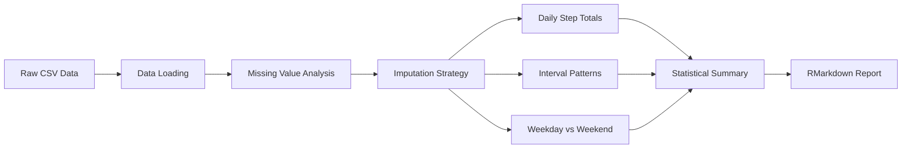

<div align="center">

# Reproducible Research: Activity Monitoring Analysis | Pesquisa Reproduzível: Análise de Monitoramento de Atividade

[](https://www.r-project.org/)
[](https://rmarkdown.rstudio.com/)
[](LICENSE)
[](Dockerfile)

**Reproducible data analysis pipeline for personal activity monitoring device data**

[English](#english) | [Português](#português)

</div>

---

## English

### Overview

A reproducible research project analyzing data from personal activity monitoring devices (pedometers/fitness trackers). The analysis processes 17,568 observations across 61 days, addressing missing data imputation, daily activity patterns, and weekday vs weekend behavior comparison using R and RMarkdown.

### Architecture



### Key Features

- **Missing Data Handling**: Strategic imputation of 2,304 NA values using interval-based averages
- **Time Series Analysis**: 5-minute interval activity patterns across 24-hour cycles
- **Comparative Analysis**: Weekday vs weekend activity pattern differentiation
- **Reproducible Pipeline**: Fully documented RMarkdown workflow with embedded visualizations

### Industry Applications

- **Health Tech**: Fitness tracker data analytics for Fitbit, Apple Health, Google Fit platforms
- **Insurance**: Actuarial analysis using physical activity data for health insurance pricing models
- **Corporate Wellness**: Employee activity monitoring programs and engagement metrics
- **Clinical Research**: Patient activity monitoring in pharmaceutical trials and rehabilitation

### Quick Start

```bash
# With Docker
docker build -t activity-analysis .
docker run activity-analysis

# Local
Rscript -e "rmarkdown::render('PA1_template.Rmd')"
```

### Fork Context

This project builds upon Coursera's Reproducible Research course (Johns Hopkins University), extending the analysis with production-grade documentation and containerization.

---

## Português

### Visão Geral

Projeto de pesquisa reproduzível analisando dados de dispositivos de monitoramento de atividade pessoal. A análise processa 17.568 observações ao longo de 61 dias, abordando imputação de dados ausentes, padrões de atividade diária e comparação entre dias úteis e fins de semana.

### Funcionalidades Principais

- **Tratamento de Dados Ausentes**: Imputação estratégica de 2.304 valores NA usando médias por intervalo
- **Análise de Séries Temporais**: Padrões de atividade em intervalos de 5 minutos ao longo de 24 horas
- **Análise Comparativa**: Diferenciação de padrões entre dias úteis e fins de semana
- **Pipeline Reproduzível**: Workflow RMarkdown completo com visualizações integradas

### Aplicações na Indústria

- **Health Tech**: Analytics de dados de rastreadores fitness para plataformas Fitbit, Apple Health, Google Fit
- **Seguros**: Análise atuarial usando dados de atividade física para precificação de seguros saúde
- **Bem-Estar Corporativo**: Programas de monitoramento de atividade de funcionários
- **Pesquisa Clínica**: Monitoramento de atividade de pacientes em trials farmacêuticos

---

## License

This project is licensed under the MIT License - see the [LICENSE](LICENSE) file for details.
